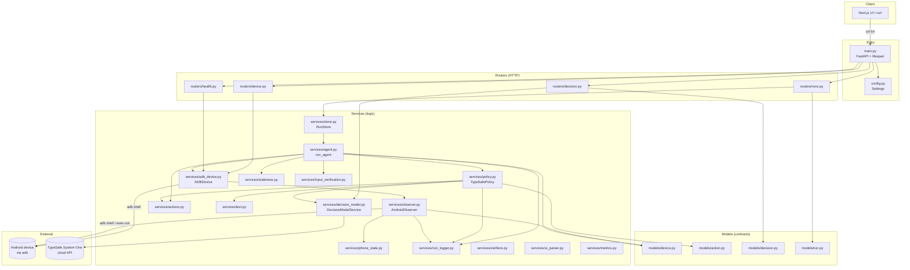
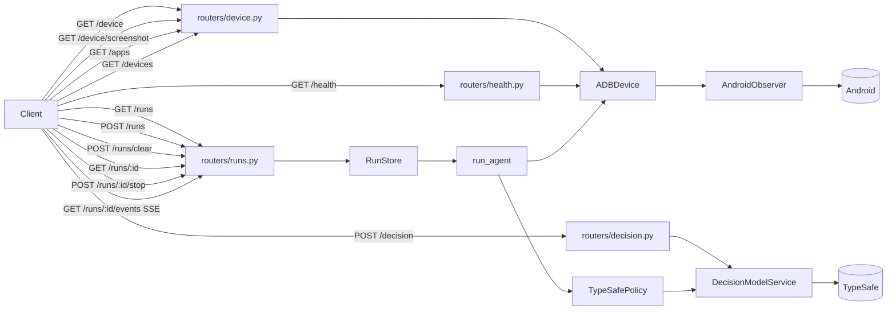
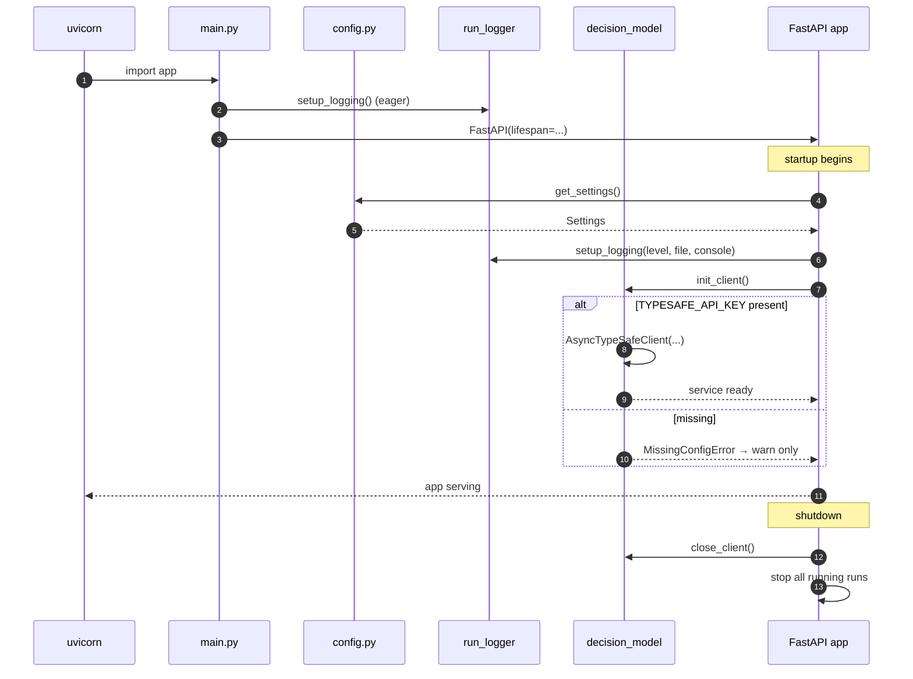
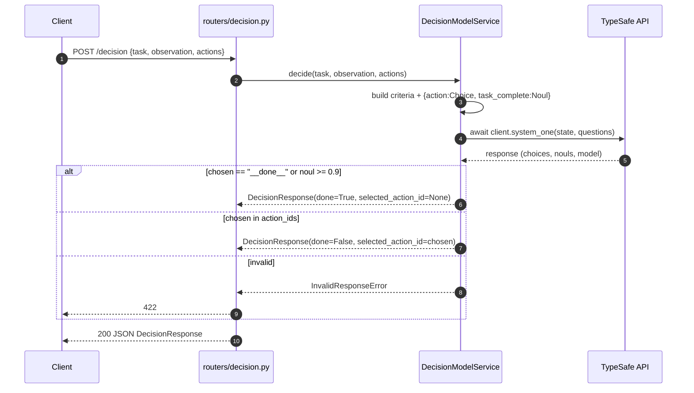
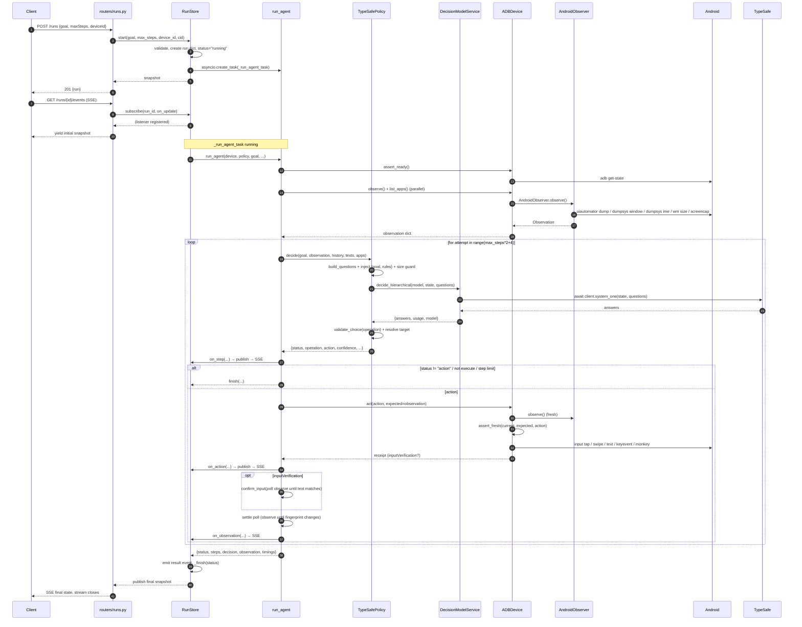
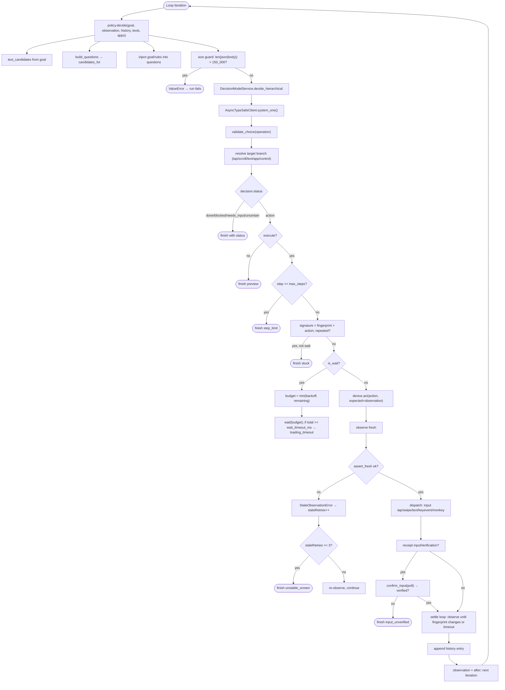
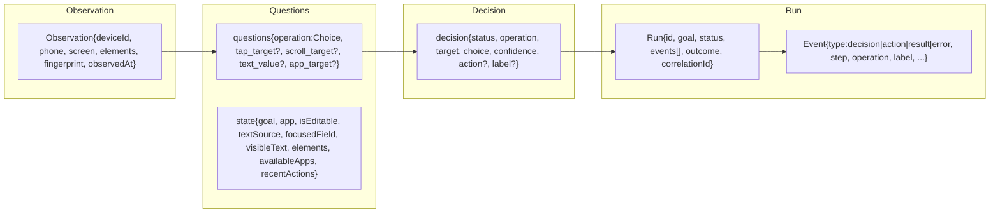

# Backend File Map + Execution Sequence (with Mermaid Diagrams)

Below is a per-file breakdown of the `backend/` tree from your screenshot, followed by Mermaid diagrams showing the sequence of a full agent run.

---

## 1. What Each File Does

### Top-level files

| File | Role |
|---|---|
| `__init__.py` | Marks `backend/` as a Python package. |
| `config.py` | Defines `Settings` (pydantic-settings) — env vars, `.env` loading, `get_settings()` cached singleton. This is where `TYPESAFE_API_KEY`, `ADB_DEVICE_SERIAL`, `LOG_LEVEL`, limits, etc. live. |
| `main.py` | FastAPI app entry point. Creates the `FastAPI` instance, attaches CORS, exception handlers, mounts routers (twice: with and without `/api/studio` prefix), and defines the `lifespan` (calls `init_client()` on startup, `close_client()` + stop runs on shutdown). |
| `pyproject.toml` | Project metadata + dependencies (`fastapi`, `uvicorn`, `httpx`, `pydantic`, `typesafe-sdk`, `sse-starlette`, …) + pytest config (`asyncio_mode = "auto"`). |
| `backend_contents.txt` | Not code — likely a dump/snapshot of the source tree (ignore for runtime). |
| `.gitignore` | Git ignore rules. |

### `models/` — Pydantic data contracts

| File | Role |
|---|---|
| `__init__.py` | Package marker. |
| `device.py` | `Bounds`, `Element`, `ScreenBounds`, `FocusedElement`, `PhoneState`, `Observation`, `DeviceInfo`, `InstalledApp`. The central `Observation` contract that everything downstream consumes. Includes dict-like `__getitem__`/`.get()` shims. |
| `action.py` | Action variant models (`TapAction`, `TapElementAction`, `SwipeAction`, `TypeAction`, `ClearAction`, `KeyAction`, `GlobalAction`, `OpenAppAction`, `WaitAction`) + `Action` union + `KEYS` / `GLOBAL_KEYCODES` maps. |
| `decision.py` | `ActionOption`, `DecisionRequest`, `DecisionResponse` — the HTTP contract for `POST /decision`. |
| `run.py` | `Event`, `Run`, `RunRequest` — the run state + SSE event contract. |

### `routers/` — HTTP surface (FastAPI `APIRouter`)

| File | Role |
|---|---|
| `__init__.py` | Package marker. |
| `device.py` | `GET /device`, `GET /device/screenshot`, `GET /apps`, `GET /devices`. Injects `ADBDevice` via `_get_device` dependency. |
| `runs.py` | `GET /runs`, `POST /runs`, `POST /runs/clear`, `GET /runs/{id}`, `POST /runs/{id}/stop`, `GET /runs/{id}/events` (SSE). Delegates to `RunStore`. |
| `decision.py` | `POST /decision` — stateless inference. Delegates to `DecisionModelService.decide`. Maps `MissingConfigError→503`, `InvalidResponseError→422`, `DecisionModelError→502`. |
| `health.py` | `GET /health` — checks ADB reachable, device ready, UI observation, TypeSafe key present. |

### `services/` — Business logic (the heart)

| File | Role |
|---|---|
| `__init__.py` | Package marker. |
| `actions.py` | `candidates_for(observation, texts)` — enumerates every possible action (taps, scrolls, back/home, enter, text entries). `describe_action(action, observation)` — human-readable labels. |
| `adb_device.py` | `ADBDevice` — the ADB transport. `_adb`, `_adb_bytes`, `_shell`, `list_devices`, `assert_ready`, `list_apps` (cached, bounded concurrency), `observe` (delegates to `AndroidObserver`), `screenshot`, `act` (dispatches taps/swipes/text/keys + staleness guard), `get_device_info`. Also has `summarize_state` (legacy/dead) and key maps. |
| `agent.py` | `run_agent` / `_run_agent_loop` — the **observe → decide → act** loop. Handles max steps, WAIT backoff, stuck detection, stale retries, input verification, settle polling, and result shaping (`{status, steps, decision, observation, timings}`). |
| `decision_model.py` | `DecisionModelService` — wraps `AsyncTypeSafeClient`. **The only place that calls the model** (`await self._client.system_one(...)`). Two methods: `decide()` (flat, for `/decision`) and `decide_hierarchical()` (multi-question, for the agent). Also `init_client`, `close_client`, `get_service`, `_safe_raise` (API-key scrubbing). |
| `input_verification.py` | `prepare_input_verification` (build receipt for `type`+`clear`), `input_matches` (does the field now contain the text?), `confirm_input` (poll until verified or timeout). |
| `metrics.py` | `summarize_metrics`, `_stats`, `TimedRequest` (mostly a stub; not wired into the main flow). |
| `observer.py` | `AndroidObserver` — parallel capture of `uiautomator dump`, `dumpsys window displays`, `dumpsys input_method`, `wm size`, `screencap`. Parses XML → `Element[]`, derives `PhoneState`, computes SHA-256 fingerprint, returns `Observation`. Defines the `ObservationError` hierarchy. |
| `phone_state.py` | `parse_phone_state(window_dump, ime_dump)` — extracts foreground package, current app, keyboard visibility, editable state. `parse_screen_size(wm_output)` — width/height. |
| `policy.py` | `TypeSafePolicy` — builds the hierarchical question set (`build_questions`), injects `{goal, rules}`, guards 150KB body size, calls `service.decide_hierarchical`, validates via `validate_choice`, resolves the chosen branch to a concrete action dict. Also `RULES` (the instruction text). |
| `run_logger.py` | `RunContext` (correlation ID), `StageContext` (stage name + duration), `CorrelationFormatter/Filter`, `sanitize_value` (redacts keys/bytes/XML), `setup_logging`. Uses `contextvars` so concurrent runs don't mix. |
| `staleness.py` | `assert_fresh(current, expected, action, max_age_ms)` — raises `StaleObservationError` if device/package/screen/age/target meaning diverged. `_target_meaning`, `_navigation_meaning` helpers. |
| `store.py` | `RunStore` — in-memory runs dict, pub/sub listeners, `asyncio.Task` per run, `start`, `stop`, `clear`, `get`, `list`, `subscribe`, `_run_agent_task`. `StudioError` (HTTP-coded app error). `get_store()` singleton. |
| `text.py` | `text_candidates(goal, supplied)` — extracts 1..8-word substrings from the goal (punctuation-stripped, deduped, overflow at 254) or returns supplied texts. |
| `ui_parser.py` | Legacy/alternate XML → a11y dict parser (`parse_ui_xml`). Only referenced by `tests/test_api.py`; production uses `observer.parse_ui_hierarchy`. |
| `verifiers.py` | `dark_theme_state`, `verify_task_completion` — heuristic completion checks (app launch, dark theme, keyword visibility). Not wired into `agent.py`; used by tests. |

### `tests/`

| File | Role |
|---|---|
| `__init__.py` | Package marker. |
| `test_api.py` | Smoke tests: app boots, models instantiate, `ui_parser` works, `/device` and `/devices` return 200 offline, `RunRequest` aliases. |
| `test_run_logger.py` | Correlation ID propagation, concurrent isolation, stage nesting, formatter output, sanitization, file/console logging, `RunStore` correlation ID. |
| `test_observer_integration.py` | Live-device observation test (skipped unless `LIVE_DEVICE_TEST=1` and `adb get-state == device`). |
| `test_agent_policy.py` | `build_questions`, `validate_choice`, `TypeSafePolicy.decide` (hierarchical), `verify_task_completion`, `run_agent` loop with mocked device/policy, config sync. |
| `test_observer.py` | XML parsing, password redaction, bounds clamping, fingerprint determinism/sensitivity, `derive_phone_state`, full pipeline with `MockADBExecutor`, error cases. |
| `test_apps_cache.py` | `ADBDevice.list_apps` cache hit/force refresh/device isolation/label fallback/concurrency/error isolation/benchmark. |
| `test_decision.py` | `DecisionModelService.decide` (valid, done via key, done via noul, invalid, timeout, connection error, key scrubbing, empty inputs), lifecycle, `/decision` endpoint (200/503/422/502/validation). |
| `test_staleness.py` | `assert_fresh` with Pydantic and dict inputs, detects changed package/screen/element/expired. |

---

## 2. Layered Architecture



---

## 3. Request Routing (who handles what)



---

## 4. Startup Sequence



---

## 5. `/decision` — Stateless Inference



---

## 6. `/runs` — Autonomous Agent (the main flow)



---

## 7. Inside One Agent Loop Iteration



---

## 8. Data Contracts at Each Hop



---

## 9. File → Responsibility Cheat Sheet

| Layer | Files | Responsibility |
|---|---|---|
| **Entry** | `main.py`, `config.py` | App wiring, lifespan, env settings |
| **HTTP** | `routers/*.py` | Validate requests, call services, shape responses, map errors to status codes |
| **Contracts** | `models/*.py` | Pydantic schemas with aliases + dict-like shims |
| **Orchestration** | `services/store.py`, `services/agent.py` | Run lifecycle, task spawning, observe→decide→act loop |
| **Decision** | `services/policy.py`, `services/actions.py`, `services/text.py` | Build question set, enumerate candidates, extract text, validate choice |
| **Model transport** | `services/decision_model.py` | **Only** place that calls `AsyncTypeSafeClient.system_one` |
| **Device** | `services/adb_device.py` | ADB commands, action dispatch, app cache, screenshot |
| **Perception** | `services/observer.py`, `services/phone_state.py`, `services/ui_parser.py` (legacy) | XML parse, fingerprint, phone state, screen size |
| **Safety** | `services/staleness.py`, `services/input_verification.py` | Freshness guard, typed-text confirmation |
| **Observability** | `services/run_logger.py` | Correlation IDs, stage timings, sanitization, formatter |
| **Heuristics** | `services/verifiers.py`, `services/metrics.py` | Completion checks, metric aggregation (stubs / not on main path) |
| **Tests** | `tests/*.py` | Unit + integration + live-device coverage |

---

## 10. TL;DR Sequence

```
Startup:   main.py → config.get_settings() → init_client() → serve
/decision: routers/decision.py → DecisionModelService.decide → system_one → DecisionResponse
/runs:     routers/runs.py → RunStore.start → asyncio task
             └─ run_agent
                  ├─ assert_ready + observe (AndroidObserver) + list_apps
                  └─ loop:
                       policy.decide → build_questions → decide_hierarchical → system_one
                                     → validate_choice → resolve action
                       device.act   → observe (fresh) → assert_fresh → adb input …
                                     → receipt → confirm_input (poll)
                       settle       → observe until fingerprint changes
                       emit events  → RunStore._publish → SSE
                  finish(status) → RunStore._finish → SSE final
```

Everything is layered so that **only `services/decision_model.py` talks to the model**, **only `services/adb_device.py` talks to ADB**, and **`services/agent.py` orchestrates without knowing either detail** — it just calls `policy.decide` and `device.act`.